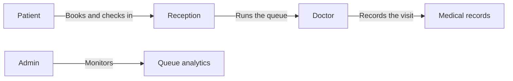
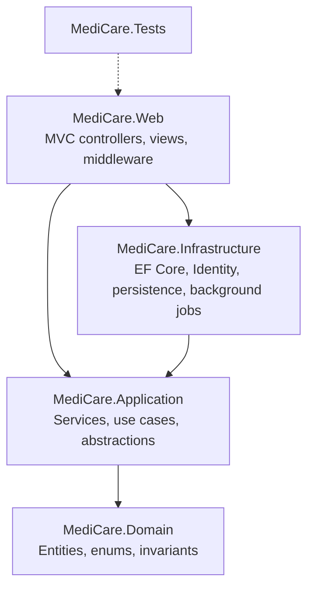

<div align="center">

# MediCare

**Clinic management, appointment booking, and queue analytics**

An ASP.NET Core MVC system that runs a clinic's daily operations: appointments, the live waiting queue, walk-ins, medical records, and measured queue performance.


</div>

---

## Table of contents

- [Overview](#overview)
- [Features](#features)
- [Roles](#roles)
- [Architecture](#architecture)
- [Tech stack](#tech-stack)
- [Getting started](#getting-started)
- [Configuration](#configuration)
- [Running the tests](#running-the-tests)
- [Project structure](#project-structure)
- [Security](#security)
- [Documentation](#documentation)

---

## Overview

Most booking apps stop at the calendar. MediCare covers what happens after that, when the clinic is full, scheduled patients and walk-ins arrive together, and a doctor has to leave early.

It brings **Patients, Doctors, Receptionists and Administrators** into one system and treats the clinic as a queue. Every arrival, call, consultation start, and completion is recorded, so the clinic can measure waiting times and utilization from real data instead of guessing.



---

## Features

### Appointments and scheduling
- Find doctors by specialization, name, and available date.
- Patient bookings stay **Pending** until Reception confirms them. Bookings made by Reception or Admin are **Confirmed** right away.
- Double booking and overlapping bookings for the same patient are prevented by a unique index, a serializable check, and a retry.
- Patients can cancel or reschedule up to the day before the visit. Reception and Admin can also act on the same day, with a reason, and reschedule atomically.
- Doctors manage weekly working hours, appointment duration, dated breaks, and holidays. Schedule changes that would break existing bookings are refused.

### Live queue
- Check-in for scheduled patients and FIFO registration for walk-ins, with one queue entry per attendance attempt.
- **Call / Call Next** serves checked-in scheduled patients by appointment time first, then approved walk-ins in FIFO order.
- Each walk-in needs a **Doctor approval**. The approval is single-use and valid for that clinic day.
- **Grace period** = 3 × the expected consultation duration, anchored to the scheduled start. A patient who doesn't arrive in time is marked **No-Show**.
- **Working-hour extensions**: Reception requests one, the Doctor approves it, and availability updates automatically.
- **Doctor leaves early**: the remaining time is blocked, affected patients go onto a worklist with a contact log, and unresolved appointments are cancelled as *clinic unavailable*, not as a No-Show.

### Medical operations
- One visit record per attendance attempt. It can be edited on the visit day, and only addenda are allowed after that.
- Prescriptions with multiple items and an active window, printable for the patient.
- Medical attachments (PDF, JPEG, PNG) stored **outside `wwwroot`** and downloadable only by authorized users.
- Full patient medical history. Access is limited to the patient and the treating doctors.

### Notifications
- In-app notifications for bookings, confirmations, cancellations, disruptions, reminders, and staff requests.

### Queue analytics
- Measured **λ, μ, ρ, Wq, Ws, Lq, Ls**, utilization, no-show rate, and walk-in throughput.
- An **M/G/1 (Pollaczek–Khinchine)** reference model, shown when ρ < 1, plus a Little's Law consistency check.
- A working-hours chart comparing scheduled and actual arrivals per clinic-local hour.
- An Admin clinic dashboard, per-doctor statistics, and a live board for Reception.

### Background maintenance
A hosted job runs every `Clinic:Maintenance:IntervalMinutes`. It processes disruptions, applies the grace period and No-Show rules, cleans up stale queue entries, resolves the previous day's appointments, and sends reminders.

### Interface
- A responsive Bootstrap 5 interface with Arabic and Latin fonts served locally.
- Light and dark themes, with the user's choice remembered.

---

## Roles

| Role | What they can do |
|---|---|
| **Admin** | Create Doctor and Receptionist accounts, reset staff passwords, deactivate staff, manage specializations and clinic settings, view clinic-wide analytics |
| **Doctor** | Manage their own schedule and profile, approve walk-ins and working-hour extensions, call patients and run consultations, write records and prescriptions, view their own statistics |
| **Receptionist** | Create patient accounts, book and confirm appointments, check patients in, register walk-ins, record disruptions, follow the live queue board |
| **Patient** | Self-register with an Egyptian mobile number, book, cancel, and reschedule appointments, view their medical history, prescriptions, and notifications |

The first Admin account is created only from secure configuration. Staff accounts start with a temporary password that is shown once and must be changed at the first sign-in.

---

## Architecture

The solution follows **Clean Architecture**. Dependencies point inward, and business rules live in the domain and application layers, not in controllers or views.



| Project | Responsibility |
|---|---|
| `MediCare.Domain` | Entities such as `Appointment`, `QueueEntry`, `Doctor`, `Patient`, `MedicalRecord`, `Prescription`, and `DoctorDisruption`, plus their invariants. It has no framework dependencies. |
| `MediCare.Application` | Application services, authorization policies, analytics calculations, and the interfaces that infrastructure implements. |
| `MediCare.Infrastructure` | `MediCareDbContext`, EF Core migrations, ASP.NET Core Identity, the clinic clock and time zone, file storage, and maintenance jobs. |
| `MediCare.Web` | MVC controllers and Razor views, rate limiting, security headers, and middleware that enforces password changes. |
| `MediCare.Tests` | xUnit unit tests, authorization tests, and in-process integration tests against a disposable LocalDB database. |

---

## Tech stack

| Area | Technology |
|---|---|
| Runtime | .NET 10 (SDK `10.0.401`, pinned in `global.json`) |
| Web | ASP.NET Core MVC, Razor, Bootstrap 5 |
| Data | Entity Framework Core 10, SQL Server / LocalDB |
| Identity | ASP.NET Core Identity with role-based authorization and custom policies |
| Testing | xUnit, `Microsoft.AspNetCore.Mvc.Testing`, coverlet |

---

## Getting started

### Prerequisites

- [.NET SDK 10.0.401](https://dotnet.microsoft.com/download) or a later feature band
- SQL Server LocalDB (included with Visual Studio), or any SQL Server instance
- The EF Core CLI:

```powershell
dotnet tool install --global dotnet-ef
```

### 1. Clone the repository

```powershell
git clone https://github.com/Georgette32/-MediCare-Clinic-Management-Appointment-Booking-System.git
cd -MediCare-Clinic-Management-Appointment-Booking-System
```

### 2. Set the bootstrap Admin (User Secrets)

The first Admin is never stored in the repository. Set it with User Secrets. The password must be at least 12 characters and include uppercase, lowercase, digit, and symbol characters.

```powershell
dotnet user-secrets set "BootstrapAdmin:Email" "admin@example.com" --project MediCare.Web
dotnet user-secrets set "BootstrapAdmin:Password" "<a strong password>" --project MediCare.Web
dotnet user-secrets set "BootstrapAdmin:FullName" "Clinic Administrator" --project MediCare.Web
```

### 3. Create the database

Migrations are not applied automatically at startup. Apply them once:

```powershell
dotnet ef database update --project MediCare.Infrastructure --startup-project MediCare.Web
```

The SQL generated for each migration is also kept in [`artifacts/`](artifacts) so it can be reviewed before running it on a shared or production database.

### 4. Run the application

```powershell
dotnet run --project MediCare.Web --launch-profile https
```

Open `https://localhost:7090` (or `http://localhost:5279`) and sign in with the Admin account you configured.

---

## Configuration

`appsettings.json` holds the shared defaults, and `appsettings.Development.json` holds the local development values.

| Key | Description | Development value |
|---|---|---|
| `ConnectionStrings:MediCare` | SQL Server connection string | LocalDB, database `MediCare` |
| `Clinic:TimeZoneId` | Clinic time zone. **Required** (there is no code default). | `Africa/Cairo` |
| `Clinic:WalkInAdmissionApproval:PendingDurationMinutes` | How long a walk-in approval request stays pending | `30` |
| `Clinic:Maintenance:IntervalMinutes` | How often the background maintenance job runs | `5` |
| `MedicalFiles:StoragePath` | Folder for medical attachments. It must be outside `wwwroot`. | `App_Data/medical-files` |
| `MedicalFiles:MaxFileSizeBytes` | Maximum attachment size | `10485760` (10 MB) |
| `RateLimiting:Auth` / `RateLimiting:Register` | Request limits for sign-in and registration | 10 per minute / 5 per hour |
| `BootstrapAdmin:*` | First Admin account. Set it with User Secrets or environment variables only. | — |

---

## Running the tests

```powershell
dotnet test MediCare.slnx
```

The suite includes domain and service unit tests, authorization tests for each role, hand-computed analytics tests, and integration tests. The integration tests start the real web application in-process against a **disposable LocalDB database** that is created and deleted automatically, so LocalDB must be available on the machine.

---

## Project structure

```
MediCare.slnx
├── MediCare.Domain/           Entities and enums
├── MediCare.Application/      Services, abstractions, policies, analytics
├── MediCare.Infrastructure/   DbContext, migrations, Identity, maintenance jobs
├── MediCare.Web/              Controllers, views, middleware, static assets
├── MediCare.Tests/            Unit and integration tests
├── artifacts/                 SQL review scripts for migrations
└── docs/                      Business, technical, and analytics documentation
```

---

## Security

- Role-based authorization plus resource-level policies, such as `MedicalRecordAccessPolicy` for medical data.
- Passwords of at least 12 characters, with account lockout after 5 failed attempts for 15 minutes.
- Temporary passwords must be changed at the next sign-in, enforced by middleware.
- Rate limiting on sign-in and registration.
- Anti-forgery validation on every form, hardened authentication cookies, and security headers.
- Medical files are stored outside the web root and served only after an authorization check.
- No secrets in the repository. The bootstrap Admin comes from User Secrets or environment variables.

---

## Documentation

| Document | Contents |
|---|---|
| [`docs/BUSINESS_IDEA.md`](docs/BUSINESS_IDEA.md) | Business requirements and model |
| [`docs/TECHNICAL_SPECIFICATION.md`](docs/TECHNICAL_SPECIFICATION.md) | Technical specification and phases |
| [`docs/ANALYTICS_MODEL.md`](docs/ANALYTICS_MODEL.md) | Queue metrics, formulas, and model assumptions |
| [`docs/DECISIONS.md`](docs/DECISIONS.md) | Confirmed business rules and design decisions |
| [`docs/PROJECT_CONTEXT.md`](docs/PROJECT_CONTEXT.md) | Current system summary |
| [`docs/PROGRESS.md`](docs/PROGRESS.md) | Phase checklist |
| [`docs/WORK_LOG.md`](docs/WORK_LOG.md) | Development history |
