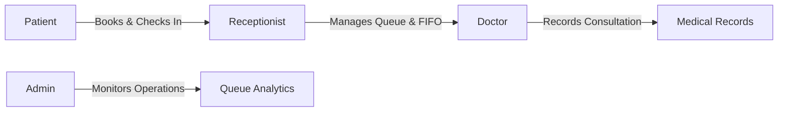
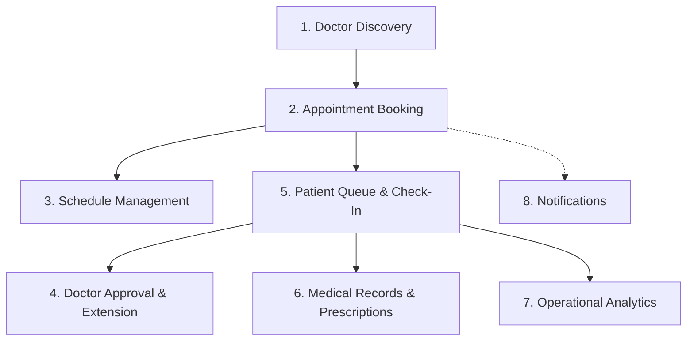

# MediCare – Business Requirements & Business Model

**Document Type:** Business Requirements & Logic<br>
**Project:** MediCare – Clinic Management System<br>
**Last Updated:** 2026-11-23<br>
**Status:** Active Reference Document<br>

---

## 1. Project Vision & Purpose

**MediCare** is an operational clinic management platform designed to organize, streamline, and optimize daily operations across multi-specialty and private clinics. It connects four key stakeholders—**Patients**, **Doctors**, **Receptionists**, and **Administrators**—within a unified, synchronized environment.

Unlike basic appointment booking apps, MediCare is an **operational throughput and queue management system**. Its core engineering purpose is to eliminate clinic congestion, optimize doctor utilization, and balance the operational friction between booked patients and walk-ins.



---

## 2. Primary Business Objective

> [!IMPORTANT]
> **Core Objective:** Minimize patient waiting time inside the clinic while maximizing the number of patients served, without compromising healthcare quality or disrupting confirmed appointments.

### Key Performance Indicators (KPIs)
1. **Average Waiting Time ($W_q$):** Duration spent waiting before consultation begins.
2. **Average System Time ($W_s$):** Total duration from clinic arrival to consultation completion.
3. **Queue Length ($L_q$):** Number of patients actively waiting in the waiting room.
4. **Doctor Utilization ($\rho$):** Fraction of working hours actively spent in consultation vs. idle time.
5. **No-Show Rate:** Percentage of scheduled appointments missed without cancellation.
6. **Walk-in Throughput:** Number of walk-in patients safely admitted without causing schedule overruns.

---

## 3. Problems Solved

| Traditional Clinic Problem | MediCare Solution |
|---|---|
| **Unpredictable Waiting Times** | Dual-queue ordering system + Queueing Theory arrival/service monitoring. |
| **Doctor Idle Time vs. Overcrowding** | Grace Period walk-in replacement workflow keeps doctors productive when patients are late. |
| **Walk-in Chaos** | Deterministic FIFO queueing with independent daily sequence numbering. |
| **Double Booking & Schedule Collisions** | Strict database-level slot uniqueness + transactional overlap prevention. |
| **Late Patient Friction** | Configurable Grace Period policy ($3 \times \text{expected consultation duration}$) with frozen guarantees. |
| **Doctor Schedule Disruption** | Structured early-departure / mass-disruption tracking with manual patient resolution. |
| **Fragmented Records** | Integrated medical records, prescriptions, and attachments tied to patient visits. |

---

## 4. Target User Roles & Authority Matrix

MediCare defines **four independent primary roles**. Role segregation is strictly enforced on the server.

```text
Admin  |  Doctor  |  Receptionist  |  Patient
```

### A. Patient
- Discovers doctors by specialization, availability, and profile.
- Books appointments (created as `Pending` until front-desk confirmation).
- Cancels own appointments strictly **before** the appointment calendar day.
- Reschedules own appointments before the appointment day (keeping original slot reserved until replacement is confirmed).
- Views personal medical records, active prescriptions, and visit history.

### B. Doctor
- Defines and manages weekly working schedules (days, start/end hours, appointment slot duration).
- Sets dated breaks and holiday periods.
- Conducts consultations; updates queue status (`Called` $\rightarrow$ `InConsultation` $\rightarrow$ `Completed`).
- Reviews and authorizes **individual walk-in admission requests** (no blanket or reusable approvals allowed).
- Approves explicit **working-hour extensions** when extra consultation time is required.
- Creates medical records, diagnoses, and multi-item prescriptions.

### C. Receptionist (Independent Primary Role)
> [!NOTE]
> Receptionist is an independent primary operational role, **not** a sub-permission of Admin.
- Receives arriving patients; executes scheduled patient check-in.
- Registers walk-in patients and records exact physical arrival timestamps.
- Manages daily FIFO walk-in waiting lines.
- Generates walk-in admission requests for doctor review.
- Executes same-day appointment cancellations with recorded mandatory reasons.
- Logs doctor early-departure / mass-disruption events and manages the patient resolution worklist.
- **Authority Boundary:** Cannot unilaterally admit walk-ins, override queue sequence, or extend doctor schedules without recorded doctor approval.

### D. Administrator
- Provisions staff accounts (Doctors, Receptionists) and links profiles to Identity users.
- Manages medical specializations and clinic-wide settings (e.g., minimum sample sizes, timezone configuration).
- Monitors operational dashboards and macro Queueing Theory metrics.
- Performs administrative cancellations and emergency rescheduling.

---

## 5. Core Business Modules



### Module 1: Doctor Discovery & Profiles
Enables patients and staff to search doctors by medical specialization, availability, and profile information. Specializations are strictly managed via standardized taxonomy.

### Module 2: Appointment Lifecycle Management
Coordinates the full appointment lifecycle through strict status transitions:
$$\text{Pending} \longrightarrow \text{Confirmed} \longrightarrow \text{Completed}$$
Alternative terminal states: $\text{Rejected}, \text{Cancelled}, \text{NoShow}, \text{Rescheduled}$.

- **Booking:** Slot duration is driven by the doctor's configured appointment duration. Requests are held as `Pending` until Reception confirms.
- **Cancellation:** Patients may cancel only before the appointment calendar day. Clinic staff may cancel on the appointment day with a recorded reason.
- **Rescheduling:** A patient replacement request reserves a linked `Pending` slot while the original remains `Confirmed`. When Reception confirms the replacement, the original transitions to `Rescheduled` in a single atomic transaction.

### Module 3: Doctor Schedule Management
Allows doctors to configure working days, shift hours, appointment slot lengths, dated breaks, and holidays.
- All slot generation derives from configured duration.
- Overlapping schedule entries and invalid time ranges are blocked.

### Module 4: Patient Queue & Attendance Management
The operational core of clinic operations. Manages two independent ordering disciplines:
1. **Scheduled Queue:** Ordered strictly by scheduled appointment time.
2. **Walk-in Queue:** Ordered strictly by FIFO arrival timestamp (`ArrivedAt ASC, QueueSequence ASC`).

### Module 5: Grace Period & Late Arrival Workflow
Addresses the common operational problem of a scheduled patient failing to arrive on time:
1. When scheduled appointment time arrives and patient has not checked in, **Grace Period begins**.
2. **Grace Period Length:** Calculated as $3 \times \text{Expected Consultation Duration}$ and frozen onto the appointment record.
3. **Walk-In Replacement:** Reception may admit a waiting walk-in patient with the doctor's explicit approval so the doctor does not sit idle.
4. **Parallel Grace Period:** The original patient's Grace Period continues while the walk-in is served.
   - *If original patient arrives within Grace Period:* They retain scheduled priority and enter consultation immediately after the active consultation completes.
   - *If Grace Period expires without arrival:* The appointment is marked `NoShow`. Any subsequent arrival must be registered as a brand-new walk-in.

### Module 6: Medical Records & Prescriptions
Stores historical diagnoses, consultation notes, laboratory attachments, and prescriptions. Prescriptions contain discrete items (medication name, dosage, frequency, duration, instructions). Access is restricted to authorized clinicians and the owning patient.

### Module 7: Notifications Engine
Keeps patients and clinicians alerted regarding booking status changes, cancellations, schedule disruptions, and upcoming appointments.

### Module 8: Operational Analytics & Queueing Theory
Applies mathematical queueing principles ($\text{M/M/1}$, $\text{M/G/1}$, or simulation) to provide actionable clinic health metrics:
- Live arrival rate ($\lambda$) and service rate ($\mu$).
- Queue length ($L_q$) and waiting time ($W_q$).
- Capacity utilization ($\rho = \lambda / \mu$) and overload warnings ($\rho \ge 1$).
- Daily working-hours graph comparing scheduled vs. actual arrival distributions.

---

## 6. Doctor Leaves Early / Mass Disruption Workflow

When a doctor must depart unexpectedly before finishing scheduled hours:
1. Reception/Admin records the disruption: Doctor, date, effective from-time, and required reason.
2. System blocks remaining working hours on that date using the dated unavailable mechanism.
3. System compiles an immediate resolution worklist containing:
   - Affected `Confirmed` appointments for that day.
   - Patients already checked in and waiting in the clinic.
4. Staff contacts each affected patient individually and logs: contacted-by, timestamp, notes, and outcome (`Pending`, `Contacted`, `Rescheduled`, `Cancelled`).
5. Any appointment remaining unresolved at its scheduled start time is automatically cancelled with reason `clinic unavailable`. It is **never** marked `NoShow` and is excluded from queueing analytics.

---

## 7. Scope & Boundaries

### In Scope
- Multi-role authentication and authorization.
- Doctor scheduling, breaks, and holiday management.
- Appointment booking, confirmation, patient/clinic cancellation, atomic rescheduling.
- Scheduled check-in and FIFO walk-in intake with daily sequence numbering.
- Grace Period calculation ($3 \times \text{expected duration}$) and freezing.
- Individual walk-in admission approvals and working-hour extensions.
- Early departure / schedule disruption management.
- Medical visit notes, prescriptions, and file attachments.
- Queueing Theory mathematical analytics engine and operational dashboard.

### Out of Scope (Future Roadmap)
- Payment processing, invoicing, and insurance billing.
- Third-party SMS/WhatsApp gateway integrations (in-app notifications provided initially).
- Multi-clinic franchise / tenant switching (single clinic instance with multi-doctor support initially).

---

## 8. Cross-References
- Technical implementation guidelines: [TECHNICAL_SPECIFICATION.md](file:///E:/train/docs/TECHNICAL_SPECIFICATION.md)
- Approved decision log: [DECISIONS.md](file:///E:/train/docs/DECISIONS.md)
- Current state and context: [PROJECT_CONTEXT.md](file:///E:/train/docs/PROJECT_CONTEXT.md)
- Complete progress checklist: [PROGRESS.md](file:///E:/train/docs/PROGRESS.md)
- Chronological engineering history: [WORK_LOG.md](file:///E:/train/docs/WORK_LOG.md)
