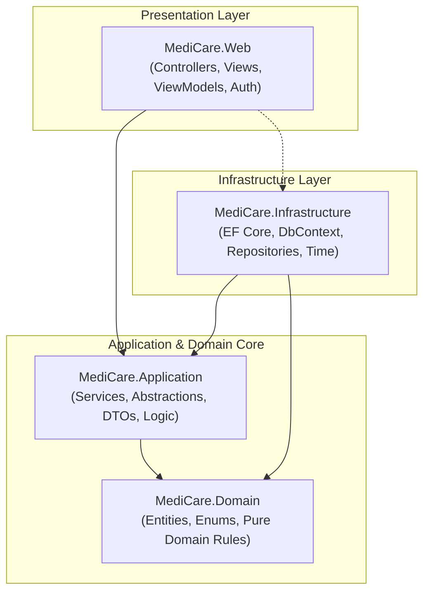
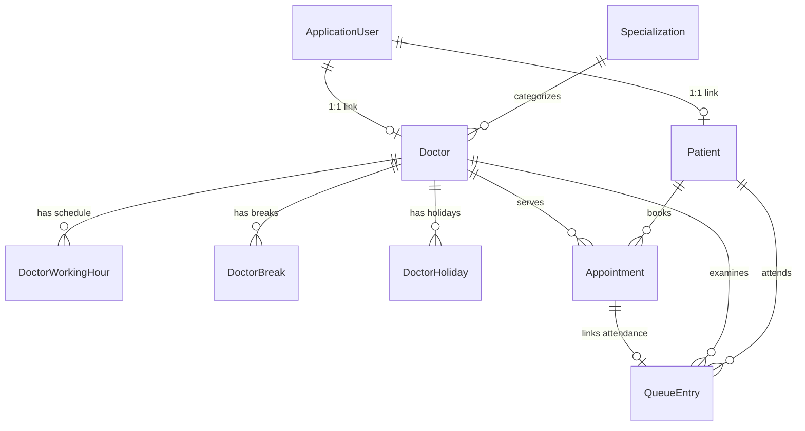

# MediCare – Technical Specification & Architecture Guidelines

**Document Type:** Technical Architecture Specification<br>
**Project:** MediCare – Clinic Management System<br>
**Last Updated:** 2026-11-23<br>
**Status:** Active Reference Document<br>

---

## 1. Technical Objectives & Constraints

MediCare is built as an **ASP.NET Core MVC** clinic operational system engineered around **Clean Architecture**.

### Primary Technical Objectives
1. **Concurrency Safety & Double-Booking Prevention:** Multiple patients booking the same slot simultaneously must never create duplicate or overlapping appointments.
2. **Deterministic Dual-Queue Execution:** Strict separation of scheduled appointment priority from FIFO walk-in queueing.
3. **Timezone Invariance:** Reliable operation across calendar-day boundaries and daylight saving time (DST) shifts using a clinic-local clock while normalizing all persistence to UTC.
4. **Data Integrity via Database Guardrails:** Enforce critical business rules at both the application layer and via physical database check constraints and filtered unique indexes.
5. **Mathematically Valid Queue Analytics:** Derive real-time operational queue metrics ($\lambda, \mu, \rho, L_s, L_q, W_s, W_q$) based on clean, empirical timestamp data.

---

## 2. Technology Stack

| Layer / Component | Technology | Version / Pinned Configuration | Status |
|---|---|---|---|
| **Runtime / SDK** | .NET | 10.0.401 (pinned in `global.json`) | **[IMPLEMENTED]** |
| **Framework** | ASP.NET Core MVC | net10.0 | **[IMPLEMENTED]** |
| **ORM** | Entity Framework Core | 10.0.0 | **[IMPLEMENTED]** |
| **Identity** | ASP.NET Core Identity / EF Core Identity | 10.0.0 | **[IMPLEMENTED]** |
| **Database Engine** | Microsoft SQL Server | LocalDB / SQL Server Express | **[IMPLEMENTED]** |
| **Authentication** | ASP.NET Core Identity | EF Core Identity Stores | **[IMPLEMENTED]** |
| **Testing** | xUnit, .NET Test SDK | 126 tests: 126 passed, 0 failed, 0 skipped (latest run, 2026-11-23) | **[IMPLEMENTED]** |
| **Frontend UI** | Razor Views, Bootstrap 5 | Bundled in Web project | **[PARTIAL]** |
| **Real-time Engine** | SignalR | ASP.NET Core SignalR | **[PROPOSED DESIGN]** |
| **Charts & Graphs** | Chart.js | JavaScript visualization | **[PROPOSED DESIGN]** |

The installed `dotnet-ef` CLI is 11.0.0 while the project EF Core packages are 10.0.0. Use a matching 10.0.0 CLI when tooling is next updated; no tool was installed as part of this stabilization.

---

## 3. Clean Architecture Solution Structure

The project strictly follows Clean Architecture. The dependency flow is inward towards Domain.

```text
MediCare.Web  -->  MediCare.Application  -->  MediCare.Domain
MediCare.Infrastructure  -->  MediCare.Application & MediCare.Domain
```



### 3.1 Layer Responsibilities

#### A. MediCare.Domain **[IMPLEMENTED]**
- **Contents:** Core domain entities, domain enums, pure invariant validation, state transition guards.
- **Strict Restrictions:** Zero dependency on EF Core, ASP.NET Core, or third-party infrastructure.

#### B. MediCare.Application **[IMPLEMENTED / EXTENSIBLE]**
- **Contents:** Application services, repository abstractions (`IAppointmentRepository`, `IQueueRepository`), unit of work abstractions (`IUnitOfWork`), system clock abstraction (`IClinicClock`), DTOs, options classes.
- **Responsibilities:** Orchestrates business transactions, enforces atomic booking/rescheduling/check-in operations.

#### C. MediCare.Infrastructure **[IMPLEMENTED]**
- **Contents:** `MediCareDbContext`, entity type configurations, repository implementations (`EfAppointmentRepository`, `EfQueueRepository`), `EfUnitOfWork`, identity stores (`ApplicationUser`, `MediCareRoles`), time services (`SystemClinicClock`, `ClinicTimeZoneResolver`), EF Core migrations.

#### D. MediCare.Web **[PARTIAL]**
- **Contents:** MVC Controllers (`AccountController`, `ReceptionController`, `HomeController`), Razor Views, navigation, request models, authentication cookies.

#### E. MediCare.Tests **[IMPLEMENTED]**
- **Contents:** Comprehensive automated tests covering domain logic, application service workflows, persistence mappings, timezone boundaries, and database constraints.

---

## 4. Server-Side Authentication & Authorization Matrix

Authorization is strictly enforced server-side via controller action attributes and service-level checks. UI element visibility alone is never relied upon for security.

| Operation | Patient | Doctor | Receptionist | Admin | Implementation Status |
|---|:---:|:---:|:---:|:---:|:---:|
| **Manage Own Profile** | Yes | Yes | Yes | Yes | **[PROPOSED DESIGN]** |
| **Search Doctors & Schedules** | Yes | Yes | Yes | Yes | **[PARTIAL]** |
| **Request Appointment Booking** | Yes | No | Operational | Operational | **[IMPLEMENTED]** |
| **Confirm / Reject Booking** | No | No | Yes | Yes | **[IMPLEMENTED]** |
| **Cancel Own Appointment (Before Day)** | Yes | No | No | No | **[IMPLEMENTED]** |
| **Cancel Appointment (Same Day + Reason)** | No | No | Yes | Yes | **[IMPLEMENTED]** |
| **Reschedule Appointment (Before Day)** | Yes | No | Yes | Yes | **[IMPLEMENTED]** |
| **Scheduled Patient Check-In** | No | No | Yes | Yes | **[IMPLEMENTED]** |
| **Walk-In Registration & FIFO Sequence** | No | No | Yes | Yes | **[IMPLEMENTED]** |
| **Walk-In Admission Approval** | No | Own Case Only | No | No | **[PROPOSED DESIGN]** |
| **Working-Hour Extension Approval** | No | Own Schedule | No | No | **[PROPOSED DESIGN]** |
| **Manage Working Hours / Breaks / Holidays** | No | Own Schedule | No | Yes | **[PARTIAL]** |
| **View Medical Records** | Own Only | Authorized Only | No (Default) | Policy-gated | **[PROPOSED DESIGN]** |
| **Create Diagnoses & Prescriptions** | No | Yes | No | No | **[PROPOSED DESIGN]** |
| **Record Doctor Early Departure / Disruption** | No | No | Yes | Yes | **[PROPOSED DESIGN]** |
| **View Queue Analytics & Dashboard** | No | Own Stats | Operational | Full Clinic | **[PROPOSED DESIGN]** |

---

## 5. Domain Entities & Database Schema



### 5.1 Implemented Entities & Constraints

#### 1. `ApplicationUser` & `MediCareRoles` **[IMPLEMENTED]**
- Standardized Identity user with `FullName` limited to 200 characters.
- Independent roles: `Admin`, `Doctor`, `Receptionist`, `Patient`.

#### 2. `Patient` **[IMPLEMENTED]**
- Fields: `Id` (GUID), `ApplicationUserId` (GUID, Unique FK to `AspNetUsers`), `FullName` (nvarchar 200), `PhoneNumber` (nvarchar 32).
- Relational rule: Strict 1:1 account link; delete restricted.

#### 3. `Doctor` **[IMPLEMENTED]**
- Fields: `Id` (GUID), `ApplicationUserId` (GUID, Unique FK to `AspNetUsers`), `FullName` (nvarchar 200), `SpecializationId` (GUID, FK to `Specializations`), `AppointmentDurationMinutes` (int), `IsActive` (bool).
- Constraint: `CK_Doctors_AppointmentDurationPositive` (`[AppointmentDurationMinutes] > 0`).

#### 4. `Specialization` **[IMPLEMENTED]**
- Fields: `Id` (GUID), `Name` (nvarchar 120, Unique), `Description` (nvarchar max, nullable).
- Relational rule: Restricted FK deletion prevents deleting specializations with active doctors.

#### 5. `DoctorWorkingHour`, `DoctorBreak`, `DoctorHoliday` **[IMPLEMENTED]**
- `DoctorWorkingHour`: `(DoctorId, DayOfWeek, StartTime)` unique index; check constraint `CK_DoctorWorkingHours_TimeRange` (`[EndTime] > [StartTime]`).
- `DoctorBreak`: Dated break periods; check constraint `CK_DoctorBreaks_TimeRange` (`[EndTime] > [StartTime]`).
- `DoctorHoliday`: Start/End date ranges; check constraint `CK_DoctorHolidays_DateRange` (`[EndDate] >= [StartDate]`).

#### 6. `Appointment` **[IMPLEMENTED]**
- Fields: `Id`, `PatientId`, `DoctorId`, `RescheduledFromAppointmentId` (nullable), `AppointmentDate` (DateOnly), `StartTime` (TimeOnly), `EndTime` (TimeOnly), `Status` (enum string max 24), `CreatedAtUtc`, `UpdatedAtUtc`, `CancellationReason` (max 500), `FrozenGracePeriodMinutes` (int, nullable), `GracePeriodStartedAtUtc` (DateTimeOffset, nullable).
- **Filtered Unique Index (Active Slot Guard):**
  ```sql
  CREATE UNIQUE INDEX [IX_Appointments_DoctorId_AppointmentDate_StartTime]
  ON [Appointments] ([DoctorId], [AppointmentDate], [StartTime])
  WHERE [Status] IN ('Pending', 'Confirmed');
  ```
- **Filtered Unique Index (Reschedule Successor Guard):**
  ```sql
  CREATE UNIQUE INDEX [IX_Appointments_RescheduledFromAppointmentId]
  ON [Appointments] ([RescheduledFromAppointmentId])
  WHERE [RescheduledFromAppointmentId] IS NOT NULL AND [Status] IN ('Pending', 'Confirmed');
  ```
- **Check Constraints:**
  - `CK_Appointments_TimeRange`: `[EndTime] > [StartTime]`
  - `CK_Appointments_GracePeriodPositive`: `[FrozenGracePeriodMinutes] IS NULL OR [FrozenGracePeriodMinutes] > 0`

#### 7. `QueueEntry` **[IMPLEMENTED]**
- Fields: `Id`, `PatientId`, `DoctorId`, `AppointmentId` (nullable), `QueueDate` (DateOnly), `Source` (`Scheduled` \| `WalkIn`), `ArrivedAt` (DateTimeOffset), `QueueSequence` (long, nullable), `Status` (`Waiting` \| `Called` \| `InConsultation` \| `Completed` \| `Cancelled` \| `NoShow`), `CalledAt`, `ConsultationStartedAt`, `CompletedAt`, `CreatedAt`.
- **Filtered Unique Index (Scheduled Appointment Link):**
  ```sql
  CREATE UNIQUE INDEX [IX_QueueEntries_AppointmentId]
  ON [QueueEntries] ([AppointmentId])
  WHERE [AppointmentId] IS NOT NULL;
  ```
- **Filtered Unique Index (Daily Walk-In FIFO Sequence):**
  ```sql
  CREATE UNIQUE INDEX [IX_QueueEntries_DoctorId_QueueDate_QueueSequence]
  ON [QueueEntries] ([DoctorId], [QueueDate], [QueueSequence])
  WHERE [QueueSequence] IS NOT NULL;
  ```
- **Filtered Unique Index (Doctor Active Consultation Invariant):**
  ```sql
  CREATE UNIQUE INDEX [IX_QueueEntries_DoctorId]
  ON [QueueEntries] ([DoctorId])
  WHERE [Status] = 'InConsultation';
  ```
- **Check Constraint (Source vs Sequence Invariant):**
  ```sql
  ALTER TABLE [QueueEntries] ADD CONSTRAINT [CK_QueueEntries_SourceAppointmentSequence]
  CHECK (
      ([Source] = 'WalkIn' AND [AppointmentId] IS NULL AND [QueueSequence] IS NOT NULL AND [QueueSequence] > 0)
      OR
      ([Source] = 'Scheduled' AND [AppointmentId] IS NOT NULL AND [QueueSequence] IS NULL)
  );
  ```

### 5.2 Proposed Entities (Upcoming Phases) **[PROPOSED DESIGN]**
- `WalkInAdmissionApproval`: `(Id, QueueEntryId, DoctorId, Decision, DecisionAt, Notes)`
- `DoctorWorkingHourExtension`: `(Id, DoctorId, ExtensionDate, OriginalEndTime, ExtendedEndTime, ApprovedByDoctorId, ApprovedAt, Reason)`
- `MedicalRecord`: `(Id, PatientId, DoctorId, AppointmentId, VisitDate, Diagnosis, Notes, CreatedAt)`
- `Prescription` & `PrescriptionItem`: Medication, dosage, frequency, duration, instructions
- `MedicalAttachment`: Secure file path, content type, uploaded metadata

---

## 6. Critical Technical Workflows & Concurrency Controls

### 6.1 Double-Booking Prevention **[IMPLEMENTED]**
Double-booking is prevented using a defense-in-depth model:
1. **Transaction Isolation:** Booking operations execute inside `IsolationLevel.Serializable` transactions via `IUnitOfWork`.
2. **Application Overlap Check:** Checks that no existing `Pending` or `Confirmed` appointment overlaps the time range `[StartTime, EndTime)`.
3. **Database Filtered Unique Index:** Blocks concurrent inserts of identical start times even if two requests pass validation simultaneously.

### 6.2 Atomic Rescheduling **[IMPLEMENTED]**
- When a patient requests rescheduling, a replacement appointment is created as `Pending` with `RescheduledFromAppointmentId` pointing to the original.
- The original appointment remains `Confirmed`, preventing slot loss if the replacement is rejected or cancelled.
- Overlap validation ignores the linked original appointment to allow shifting within the same day.
- When Reception confirms the replacement, both replacement confirmation and marking the original as `Rescheduled` occur within a single serializable transaction.
- Same-slot rescheduling (identical doctor, date, and start time) is explicitly rejected.

### 6.3 Clinic Timezone Engine (`IClinicClock`) **[IMPLEMENTED]**
- All timestamps stored in database tables are normalized to UTC `DateTimeOffset`.
- Calendar-day comparisons (e.g., determining whether today is the appointment day) use `IClinicClock.Today`, resolved via the clinic's configured timezone (`Africa/Cairo`).
- The clock converts UTC instants to the local timezone without constructing synthetic local midnight instants, preventing errors during daylight saving transitions.

### 6.4 Expected Duration & Grace Period Engine **[IMPLEMENTED]**
1. **Expected Consultation Duration:**
   - Trailing 30 clinic-local days: query completed visits where `Status == Completed` and `ConsultationStartedAt` and `CompletedAt` are not null.
   - Duration filter: $0 < \text{duration} < 60\text{ minutes}$ (named constant: `ExpectedDurationOptions.DefaultMaxDurationMinutesCap`).
   - Sample threshold: If sample size < configurable `MinimumSampleSize` (or unset), fall back to `Doctor.AppointmentDurationMinutes`.
2. **Grace Period Calculation:**
   $$\text{Grace Period Minutes} = 3 \times \text{Expected Consultation Duration}$$
   - Triggered at appointment time if patient is absent.
   - Frozen directly onto `Appointment.FrozenGracePeriodMinutes` and `Appointment.GracePeriodStartedAtUtc`.

---

## 7. Queueing Theory Mathematical Engine **[PROPOSED DESIGN - Phase 4]**

### 7.1 Required Operational Data Collection
Every consultation records empirical timestamps:
- $T_{\text{arr}}$: Physical arrival time (`QueueEntry.ArrivedAt`)
- $T_{\text{sched}}$: Scheduled appointment time (`Appointment.StartTime`)
- $T_{\text{call}}$: Time called into examination (`QueueEntry.CalledAt`)
- $T_{\text{start}}$: Actual consultation start (`QueueEntry.ConsultationStartedAt`)
- $T_{\text{end}}$: Actual consultation completion (`QueueEntry.CompletedAt`)

### 7.2 Derived Metrics & Formulas
1. **Service Duration ($S$):**
   $$S = T_{\text{end}} - T_{\text{start}}$$
2. **Arrival Rate ($\lambda$):**
   $$\lambda = \frac{\text{Total Patient Arrivals}}{\text{Observation Time Window}}$$
3. **Service Rate ($\mu$):**
   $$\mu = \frac{1}{\bar{S}} = \frac{1}{\text{Average Service Duration}}$$
4. **Traffic Intensity / Utilization ($\rho$):**
   $$\rho = \frac{\lambda}{\mu}$$
5. **Stability Condition:**
   - Steady state exists only when $\rho < 1$.
   - When $\rho \ge 1$, the system is **overloaded / unstable**. The dashboard must flag the overload instead of displaying meaningless negative or infinite theoretical steady-state numbers.
6. **Little's Law Validation:**
   $$L_s = \lambda \cdot W_s \quad \text{and} \quad L_q = \lambda \cdot W_q$$
   - $L_s$: Average patients in system (waiting + being served)
   - $L_q$: Average patients in queue (waiting room only)
   - $W_s$: Average time spent in clinic
   - $W_q$: Average waiting time before consultation

---

## 8. Cross-References
- Business requirements and roles: [BUSINESS_IDEA.md](file:///E:/train/docs/BUSINESS_IDEA.md)
- Approved decisions & open topics: [DECISIONS.md](file:///E:/train/docs/DECISIONS.md)
- Current project context & setup: [PROJECT_CONTEXT.md](file:///E:/train/docs/PROJECT_CONTEXT.md)
- Master progress tracking: [PROGRESS.md](file:///E:/train/docs/PROGRESS.md)
- Work history & test records: [WORK_LOG.md](file:///E:/train/docs/WORK_LOG.md)
